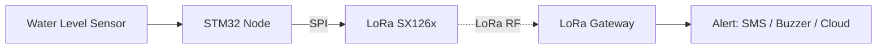
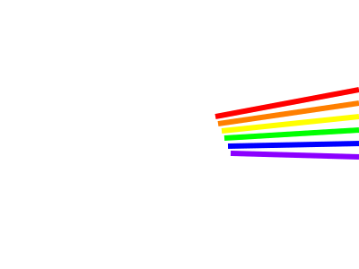

<!-- ======================================================= -->
<!--                        HEADER                           -->
<!-- ======================================================= -->

  

 

<!-- ======================================================= -->
<!--                        ABOUT                            -->
<!-- ======================================================= -->
## 👨‍💻 About Me

I'm an aspiring Embedded Systems Engineer who loves hardware, microcontrollers, and low-level programming.I learn by building: reading datasheets, wiring up boards, and debugging at the register level.Ultimately, my goal is to build robust, low-power firmware that solves real-world problems especially in IoT and disaster prevention.

<table>
<tr>
<td>

🔭 **Currently building** 
FLash Flood Warning System (STM32 + LoRa SX126x)(LoRa mesh hop network)

🌱 **Currently learning** 
Embedded system architecture, FreeRTOS, and register-level hardware debugging

</td>
<td>

🎯 **Goals** 
Mastering embedded system architectures to design robust, real-time IoT solutions for critical real-world challenges.

💬 **Ask me about** 
STM32, ESP32, IoT, STM32-HAL, STM32-LL, 42 curriculum

</td>
</tr>
</table>

<!-- ======================================================= -->
<!--                        SKILLS                           -->
<!-- ======================================================= -->
## 🛠️ Skills & Technologies

**Languages** 

**Hardware / Microcontrollers** 

**Protocols & Interfaces** 

**Tools & Platforms** 

  

<!-- ======================================================= -->
<!--                      PROJECTS                           -->
<!-- ======================================================= -->
## 🚀 My Projects

| Status | Project | Tech |
|:---:|---|---|
| ✅ Completed | **IoT Hydroponic System**: automates watering, nutrients and monitoring for plants | ESP32, Sensors, IoT |
| 🔧 In Progress | **Flood Disaster Warning System**: long-range, low-power flood alerts | STM32, LoRa (SX126x), SPI |
| 🔍 Always | Hardware-software integration and exploring new MCU architectures | C, HAL, Datasheets |

<b>📡 Flood Disaster Warning System: how it works (click to expand)</b>

 

A remote sensor node measures water level and sends it over **LoRa** to a gateway, which raises an alert when a threshold is crossed. LoRa makes it possible to cover rural river areas with no Wi-Fi or cellular coverage, using very little power.

**What I'm working on**
- SX126x driver in C on STM32 HAL (SetStandby, SetPacketParams, SetTx, IRQ handling on DIO1)
- Reliable TX/RX with BUSY-pin handling and timeouts
- Low-power sleep between measurements

<!-- ======================================================= -->
<!--                      42 SCHOOL                          -->
<!-- ======================================================= -->
##  42 School Projects

*Learning low-level C programming, system architecture, and manual memory management through the 42 curriculum.*

<table>
<tr>
<td align="center">
  
</td>
<td align="center">
  
</td>
</tr>
<tr>
<td align="center">
  
</td>
<td align="center">
  
</td>
</tr>
</table>

<!-- ======================================================= -->
<!--                  LEADERSHIP & COMMUNITY                 -->
<!-- ======================================================= -->
## 🌟 Leadership & Community

- 🎓 **Founder, [Impact Education](https://impactedu.impacteducation650.workers.dev/)**: an initiative dedicated to making learning accessible to everyone.

<!-- ======================================================= -->
<!--                        STATS                            -->
<!-- ======================================================= -->
## 📊 GitHub Stats

  

<!-- SNAKE ANIMATION: .github/workflows/snake.yml ကို run ပြီးမှ ပေါ်ပါမယ် -->

  <picture>
    <source media="(prefers-color-scheme: dark)" srcset="https://raw.githubusercontent.com/Arkarchanmyae123/Arkarchanmyae123/output/github-snake-dark.svg" />
    <source media="(prefers-color-scheme: light)" srcset="https://raw.githubusercontent.com/Arkarchanmyae123/Arkarchanmyae123/output/github-snake.svg" />
    
  </picture>

<!-- ======================================================= -->
<!--                        CONTACT                          -->
<!-- ======================================================= -->
## 📫 Let's Connect

I'm open to **collaborations, mentorship, and learning opportunities** in embedded systems and IoT. Feel free to reach out.

  

 

  <i>"The sun is the same in a relative way but you're older, Shorter of breath and one day closer to death."</i>  
  

 

  

