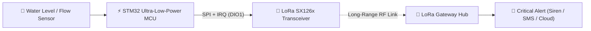
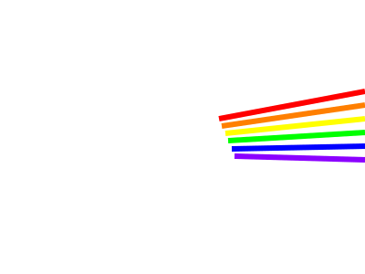



<!-- HEADER BANNER -->

<!-- TYPING ANIMATION -->

  

<!-- TOP STATUS BADGES -->

 

---

### 👨‍💻 About Me

I am an **Embedded Systems Engineer** passionate about microcontrollers, low-level architecture, and bare-metal firmware. My approach to learning is strictly hands-on: diving into silicon datasheets, analyzing hardware schematics, tracing bus signals, and debugging at the register level.

My primary mission is designing **reliable, power-efficient, and fail-safe IoT systems** that solve real-world problems—focusing on environmental telemetry, disaster mitigation, and distributed off-grid communication networks.

 

<table align="center" width="100%">
<tr>
<td width="50%" valign="top">

#### 🔭 Focus & Active Builds
- **Disaster Prevention**: Engineering a distributed Flash Flood Warning Node Network using **STM32** + **LoRa SX126x** multi-hop mesh.
- **Signal Processing**: Decoding and analyzing satellite wave telemetry in pure C.
- **Bare-Metal Drivers**: Writing custom hardware register drivers for STM32 Cortex-M.

</td>
<td width="50%" valign="top">

#### 🌱 Technical Pursuits & Goals
- **Architecture**: Mastering FreeRTOS, memory management, and deterministic systems.
- **Hardware Integration**: High-reliability peripheral buses (**SPI**, **I2C**, **USART**, **DMA**).
- **Core Philosophy**: Building firmware close to the metal with zero unnecessary overhead.

</td>
</tr>
</table>

 

---

### 🛠️ Technical Arsenal

#### Programming Languages

  
  
  
  
  

#### Hardware & Microcontrollers

  
  
  

#### Protocols & Low-Level Interfaces

  
  
  
  
  

#### Toolchains & Development Platforms

  
  
  
  
  
  
  

 

---

### 🚀 Featured Engineering Projects

| Status | Project | Description | Core Stack |
|:---:|---|---|:---:|
| 🔧 **Active** | [**Flash Flood Warning Node Module**](https://github.com/Arkarchanmyae123/Flash_Flood_Warning_Node_Module) | Long-range, low-power mesh node for early disaster alerts in rural off-grid river zones. | `STM32` `LoRa SX126x` `SPI` `C` |
| 🛰️ **Active** | [**Satellite Wave File Processor**](https://github.com/Arkarchanmyae123/satellite_wave_file) | Satellite RF signal wave file decoding, audio telemetry extraction, and signal inspection. | `C` `Signal Processing` `DSP` |
| ⚡ **Core** | [**STM32 Blue Pill Register Drivers**](https://github.com/Arkarchanmyae123/bluePill_register_Stm32_with_driver) | Bare-metal driver development manipulating memory-mapped peripheral registers directly without HAL overhead. | `ARM Cortex-M` `Registers` `C` |
| ✅ **Shipped** | [**IoT Hydroponics & Aeroponics**](https://github.com/Arkarchanmyae123/hydroponic_monitor_app_demo) | Automated nutrient dosing, environmental parameter monitoring, and sensor loop control. | `ESP32` `Sensors` `Python` `IoT` |

 

<b>📡 Deep Dive: Flash Flood Disaster Warning Architecture (Click to expand)</b>

 

A distributed battery-operated node system deployed in remote riverbeds where cellular networks are unavailable. The sensing nodes read water level and flow metrics, packetize the telemetry, and transmit across long distances using **LoRa RF** modulation to alerting gateways.

**Key Architectural Highlights:**
- Custom **SX126x** driver implemented in C over hardware SPI with BUSY-pin state machine and timeout management.
- Dynamic packet validation, CRC checks, and multi-hop relay forwarding.
- Deep sleep power cycling optimizing battery endurance for multi-year remote deployment.

 

---

### 🏫 42 School Curriculum Projects

> *Mastering low-level systems programming, data structures, and rigorous memory management without relying on standard libraries.*

<table align="center">
<tr>
<td align="center">
  
</td>
<td align="center">
  
</td>
</tr>
<tr>
<td align="center">
  
</td>
<td align="center">
  
</td>
</tr>
</table>

 

 

 

---

### 🌟 Leadership & Community

- 🎓 **Founder, [Impact Education](https://impactedu.impacteducation650.workers.dev/)**  
  *An open initiative dedicated to empowering aspiring engineers through accessible tech education, embedded systems mentorship, and free resources.*

 

---

### 📊 GitHub Activity & Metrics

  

  

<!-- Contribution Snake Animation: .github/workflows/snake.yml ကို run ပြီးမှ ပေါ်ပါမယ် -->
<picture>
  <source media="(prefers-color-scheme: dark)" srcset="https://raw.githubusercontent.com/Arkarchanmyae123/Arkarchanmyae123/output/github-snake-dark.svg" />
  <source media="(prefers-color-scheme: light)" srcset="https://raw.githubusercontent.com/Arkarchanmyae123/Arkarchanmyae123/output/github-snake.svg" />
  
</picture>

 

---

### 🎵 Engineering Philosophy & Soundtrack

  

> *"The sun is the same in a relative way, but you're older, *
> *Shorter of breath and one day closer to death."*  
> 
> — **Pink Floyd**, *Time* (*The Dark Side of the Moon*, 1973)

 

 

---

### 📫 Connect With Me

  I am always open to discussing <b>embedded systems architecture, firmware engineering, IoT innovations, and low-level C projects</b>.

  

 

<!-- FOOTER BANNER -->

